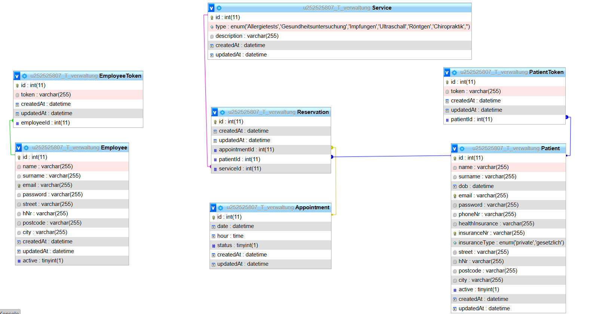

# MediBooker-API

## Description

MediBooker-API ist eine umfassende Web-basierte Anwendung zur Verwaltung von Praxisterminen, die es Ärzten und medizinischem Personal ermöglicht, Patiententermine einfach zu planen und zu koordinieren. Die API bietet Echtzeit-Updates, sichere Authentifizierung und eine intuitive Benutzeroberfläche für die effiziente Verwaltung medizinischer Termine.

Eine Live-Demo der Anwendung ist verfügbar unter: [MediBooker API](https://medi-booker-ap-i.vercel.app/)

## Features

- 🏥 **Terminverwaltung**: Vollständige CRUD-Operationen für Termine und Reservierungen
- 👥 **Benutzerverwaltung**: Separate Verwaltung für Patienten und medizinisches Personal
- 🔐 **Sichere Authentifizierung**: JWT-basierte Authentifizierung mit Token-Management
- ⚡ **Echtzeit-Updates**: WebSocket-Integration für Live-Updates
- 📊 **Service-Management**: Verwaltung medizinischer Dienstleistungen
- 🗄️ **Datenbank-Integration**: Sequelize ORM mit MySQL/PostgreSQL Support
- 📚 **API-Dokumentation**: Vollständige Swagger/OpenAPI Dokumentation
- 🚀 **Cloud-Deployment**: Vercel-Integration für einfaches Deployment
- 🔧 **Fehlerbehandlung**: Zentrale Fehlerbehandlung mit detailliertem Logging
- 📱 **Responsive Design**: Mobile-freundliche Benutzeroberfläche

## Technology Stack

- **Backend**: Node.js, Express.js
- **Database**: MySQL/PostgreSQL mit Sequelize ORM
- **Authentication**: JWT (JSON Web Tokens)
- **Real-time Communication**: Socket.IO
- **API Documentation**: Swagger/OpenAPI
- **Deployment**: Vercel
- **Version Control**: Git

## Prerequisites

Before using the MediBooker-API, ensure you have the following installed:

- Node.js (v14 oder höher)
- npm (v6 oder höher)
- MySQL oder PostgreSQL Datenbank
- Git (für Version Control)

## Installation

### 1. Repository klonen

```bash
git clone https://github.com/your-username/MediBooker-API.git
cd MediBooker-API
```

### 2. Dependencies installieren

```bash
npm install
```

### 3. Umgebungsvariablen konfigurieren

Erstelle eine `.env` Datei im Root-Verzeichnis:

```env
# Database Configuration
DB_HOST=localhost
DB_PORT=3306
DB_NAME=medibooker
DB_USER=your_username
DB_PASSWORD=your_password

# JWT Configuration
JWT_SECRET=your_jwt_secret_key
JWT_EXPIRES_IN=24h

# Server Configuration
PORT=3000
NODE_ENV=development

# WebSocket Configuration
WEBSOCKET_PORT=3001
```

### 4. Datenbank einrichten

```bash
# Datenbank-Schema synchronisieren
node sync-db.js

# Testdaten generieren (optional)
node fakedata.js
```

### 5. Server starten

```bash
# Development Mode
npm start

# Oder mit nodemon für automatisches Neuladen
npm run dev
```

## Project Structure

```
MediBooker-API/
├── config/                 # Datenbank-Konfiguration
│   └── dbConfig.js
├── controllers/           # API Controller
│   ├── AppointmentController.js
│   ├── employeesController.js
│   ├── patientsController.js
│   ├── ReservationController.js
│   └── ServiceController.js
├── middlewares/          # Express Middleware
│   ├── authenticateToken.js
│   ├── errorHandler.js
│   ├── Socket.js
│   └── tockenService.js
├── models/              # Sequelize Models
│   ├── Appointment.js
│   ├── Employee.js
│   ├── EmployeeToken.js
│   ├── Patient.js
│   ├── PatientToken.js
│   ├── Reservation.js
│   └── Service.js
├── routes/              # API Routes
│   ├── appointmentRoutes.js
│   ├── employeesRoutes.js
│   ├── patientsRoutes.js
│   ├── reservationRoutes.js
│   └── serviceRoutes.js
├── services/            # Business Logic
│   ├── websockets/
│   │   ├── websocketHandlers.js
│   │   ├── websocketInit.js
│   │   └── websocketNotify.js
│   └── websocketService.js
├── doc/                 # Dokumentation
│   ├── db.relations.png
│   └── doc.txt
├── index.js             # Hauptanwendung
├── package.json
├── swagger.js           # Swagger Konfiguration
└── vercel.json          # Vercel Deployment
```

## Database Management



### Datenbank-Schema

Die Anwendung verwendet folgende Hauptentitäten:

- **Patients**: Patienteninformationen
- **Employees**: Medizinisches Personal
- **Appointments**: Termine
- **Reservations**: Reservierungen
- **Services**: Medizinische Dienstleistungen
- **Tokens**: Authentifizierungstoken

## API Endpoints

### Authentication
- `POST /api/auth/login` - Benutzeranmeldung
- `POST /api/auth/register` - Benutzerregistrierung
- `POST /api/auth/logout` - Benutzerabmeldung
- `POST /api/auth/refresh` - Token erneuern

### Patients
- `GET /api/patients` - Alle Patienten abrufen
- `GET /api/patients/:id` - Einzelnen Patienten abrufen
- `POST /api/patients` - Neuen Patienten erstellen
- `PUT /api/patients/:id` - Patienten aktualisieren
- `DELETE /api/patients/:id` - Patienten löschen

### Employees
- `GET /api/employees` - Alle Mitarbeiter abrufen
- `GET /api/employees/:id` - Einzelnen Mitarbeiter abrufen
- `POST /api/employees` - Neuen Mitarbeiter erstellen
- `PUT /api/employees/:id` - Mitarbeiter aktualisieren
- `DELETE /api/employees/:id` - Mitarbeiter löschen

### Appointments
- `GET /api/appointments` - Alle Termine abrufen
- `GET /api/appointments/:id` - Einzelnen Termin abrufen
- `POST /api/appointments` - Neuen Termin erstellen
- `PUT /api/appointments/:id` - Termin aktualisieren
- `DELETE /api/appointments/:id` - Termin löschen

### Reservations
- `GET /api/reservations` - Alle Reservierungen abrufen
- `GET /api/reservations/:id` - Einzelne Reservierung abrufen
- `POST /api/reservations` - Neue Reservierung erstellen
- `PUT /api/reservations/:id` - Reservierung aktualisieren
- `DELETE /api/reservations/:id` - Reservierung löschen

### Services
- `GET /api/services` - Alle Services abrufen
- `GET /api/services/:id` - Einzelnen Service abrufen
- `POST /api/services` - Neuen Service erstellen
- `PUT /api/services/:id` - Service aktualisieren
- `DELETE /api/services/:id` - Service löschen

## Database Operations

### Datenbank verwalten

```bash
# Datenbank löschen (ACHTUNG: Löscht alle Daten!)
node drop-db.js

# Datenbank-Schema synchronisieren
node sync-db.js

# Testdaten generieren
node fakedata.js
```

## API Documentation

### Swagger Interface starten

```bash
node swagger.js
```

Nach dem Start ist die interaktive API-Dokumentation verfügbar unter:
- **Swagger UI**: `http://localhost:3000/api-docs`
- **JSON Schema**: `http://localhost:3000/swagger-output.json`

### API-Testing

Die Swagger-Oberfläche ermöglicht:
- Interaktives Testen aller Endpoints
- Authentifizierung mit JWT-Token
- Request/Response-Beispiele
- Schema-Validierung

## Deployment

### Vercel Deployment

#### Lokale Entwicklung

```bash
# Vercel CLI installieren
npm install -g vercel

# Lokale Entwicklung mit Vercel
vercel dev
```

#### Produktions-Deployment

```bash
# Projekt builden
vercel build

# Produktions-Deployment
vercel --prod
```

### Umgebungsvariablen für Vercel

Konfiguriere folgende Umgebungsvariablen in der Vercel-Konsole:

```env
DB_HOST=your_database_host
DB_PORT=3306
DB_NAME=your_database_name
DB_USER=your_database_user
DB_PASSWORD=your_database_password
JWT_SECRET=your_jwt_secret
NODE_ENV=production
```

## Documentation

### WebSocket-Integration in der Anwendung

Diese Anwendung verwendet WebSockets, um Echtzeitkommunikation zwischen dem Server und den Clients zu ermöglichen. Die WebSocket-Implementierung erfolgt mithilfe von Socket.IO, das sowohl den Server- als auch den Client-Teil abdeckt.

#### Einrichtung von WebSockets

Die WebSocket-Server-Initialisierung und Ereignisbehandlung erfolgt in separaten Dateien im Verzeichnis `services/websockets`.

##### WebSocket-Server-Initialisierung

- **websocketInit.js**: Diese Datei initialisiert den WebSocket-Server durch die Funktion `initializeWebSocketServer`, die in der Hauptanwendungsdatei (`index.js`) aufgerufen wird.

##### WebSocket-Ereignisbehandlung

- **websocketHandlers.js**: Diese Datei behandelt die verschiedenen WebSocket-Ereignisse wie Verbindung, Nachricht und Trennung. Die Funktion `handleConnection` wird aufgerufen, wenn ein Client eine Verbindung herstellt.

##### WebSocket-Benachrichtigungen

- **websocketNotify.js**: Diese Datei enthält die Funktion `notifyClients`, um Benachrichtigungen an die verbundenen Clients zu senden. Die `setIo`-Funktion wird verwendet, um die `io`-Instanz zu setzen, die für die Benachrichtigung der Clients benötigt wird.

##### Einbindung des WebSocket-Servers

In der Hauptanwendungsdatei (`index.js`) wird der WebSocket-Server gestartet, nachdem der HTTP-Server erstellt wurde. Die `io`-Instanz wird gesetzt, um Benachrichtigungen an die Clients zu ermöglichen.

##### WebSocket-Ereignisse

Der WebSocket-Server kann auf spezifische Ereignisse hören und entsprechende Aktionen ausführen. Beispielsweise können bei Änderungen in der Datenbank (z.B. bei der Erstellung, Aktualisierung oder Löschung von Reservierungen) Benachrichtigungen an alle verbundenen Clients gesendet werden.

##### Vorteile der WebSocket-Integration

- **Echtzeitkommunikation**: Änderungen werden sofort an alle verbundenen Clients gesendet, wodurch eine Echtzeitkommunikation ermöglicht wird.
- **Effizienz**: WebSockets sind effizienter als wiederholte HTTP-Anfragen, da sie eine dauerhafte Verbindung zwischen Client und Server ermöglichen.
- **Benutzererfahrung**: Echtzeit-Updates verbessern die Benutzererfahrung erheblich, indem sie sicherstellen, dass die Benutzer immer aktuelle Informationen sehen.

Mit dieser Integration von WebSockets stellt die MediBooker-API sicher, dass alle relevanten Informationen in Echtzeit an die Benutzer weitergegeben werden, was die Effizienz und Benutzererfahrung der Anwendung erheblich verbessert.

## Troubleshooting

### Häufige Probleme und Lösungen

#### Datenbankverbindung fehlgeschlagen
```bash
# Überprüfe Datenbankverbindung
node -e "console.log('Testing database connection...')"
```

#### JWT-Token Probleme
- Überprüfe `JWT_SECRET` in der `.env` Datei
- Stelle sicher, dass Token nicht abgelaufen sind
- Überprüfe Token-Format in den Headers

#### WebSocket-Verbindung
- Überprüfe Port-Konfiguration
- Stelle sicher, dass CORS richtig konfiguriert ist
- Überprüfe Firewall-Einstellungen

#### Vercel Deployment Probleme
```bash
# Logs überprüfen
vercel logs

# Lokale Umgebung testen
vercel dev
```

### Debug-Modus aktivieren

```bash
# Mit Debug-Logging starten
DEBUG=* npm start

# Oder spezifische Module debuggen
DEBUG=app:*,websocket:* npm start
```

## Contributing

### Entwicklungsumgebung einrichten

1. Fork das Repository
2. Erstelle einen Feature-Branch
3. Installiere Dependencies: `npm install`
4. Konfiguriere Umgebungsvariablen
5. Starte die Entwicklungsumgebung

### Code-Standards

- Verwende ESLint für Code-Qualität
- Schreibe Tests für neue Features
- Dokumentiere API-Änderungen
- Folge den bestehenden Namenskonventionen

### Pull Request Prozess

1. Erstelle einen aussagekräftigen Titel
2. Beschreibe die Änderungen detailliert
3. Füge Tests hinzu (falls zutreffend)
4. Stelle sicher, dass alle Tests bestehen
5. Aktualisiere die Dokumentation

## License

Dieses Projekt steht unter der MIT-Lizenz. Siehe `LICENSE` Datei für Details.

## Support

Bei Fragen oder Problemen:

- Erstelle ein Issue im GitHub Repository
- Kontaktiere das Entwicklungsteam
- Überprüfe die Dokumentation

## Changelog

### Version 1.0.0
- Initiale Release
- Vollständige CRUD-Operationen
- JWT-Authentifizierung
- WebSocket-Integration
- Swagger-Dokumentation
- Vercel-Deployment

### Fehlerbehandlung in der Anwendung

Diese Anwendung verwendet eine zentrale Fehlerbehandlungsmiddleware, um sicherzustellen, dass alle Fehler konsistent verarbeitet und protokolliert werden. Dies hilft, die Anwendung robuster und wartbarer zu machen.

#### Fehler-Middleware

Die Fehler-Middleware befindet sich im Verzeichnis middlewares und heißt errorHandler.js. Diese Middleware fängt alle Fehler ab, die in der Anwendung auftreten, protokolliert den Fehlerstack und sendet eine konsistente JSON-Antwort an den Client.

- **Protokollierung**: Die Middleware protokolliert den Fehlerstack zur Diagnose.
- **Antwort**: Eine JSON-Antwort mit dem Fehlerstatus und der Fehlermeldung wird an den Client gesendet.
- **Umgebung**: Im Entwicklungsmodus (NODE_ENV=development) werden zusätzliche Fehlerinformationen gesendet.

#### Einbindung der Fehler-Middleware

Die Fehler-Middleware wird in der Hauptanwendungsdatei (index.js) eingebunden. Sie wird als letzte Middleware in der Middleware-Kette verwendet, um sicherzustellen, dass alle Fehler, die während der Verarbeitung von Anfragen auftreten, abgefangen werden.

#### Fehlerweitergabe in Controllern

In den Controllern und Routen wird sichergestellt, dass alle auftretenden Fehler an die Fehler-Middleware weitergegeben werden. Dies geschieht durch Aufrufen der next-Funktion mit dem Fehlerobjekt.

#### Vorteile der zentralen Fehlerbehandlung

- **Konsistenz**: Alle Fehler werden auf die gleiche Weise behandelt und protokolliert.
- **Wartbarkeit**: Änderungen am Fehlerbehandlungsverhalten müssen nur an einer Stelle vorgenommen werden.
- **Sicherheit**: Im Produktionsmodus werden keine sensiblen Fehlerinformationen an den Client gesendet.
- **Diagnose**: Im Entwicklungsmodus werden detaillierte Fehlerinformationen bereitgestellt, die bei der Diagnose und Behebung von Problemen helfen.
